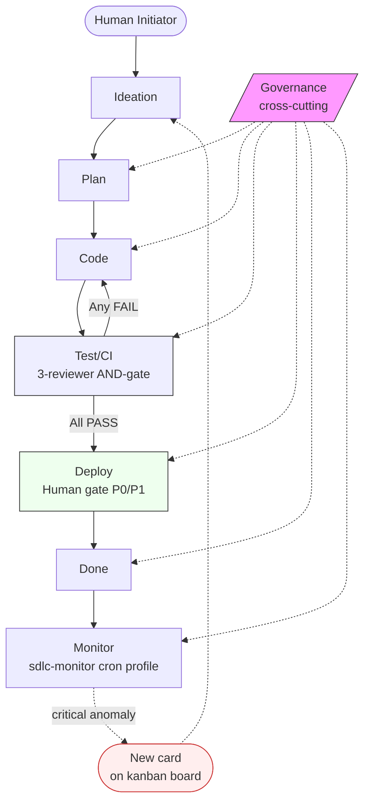
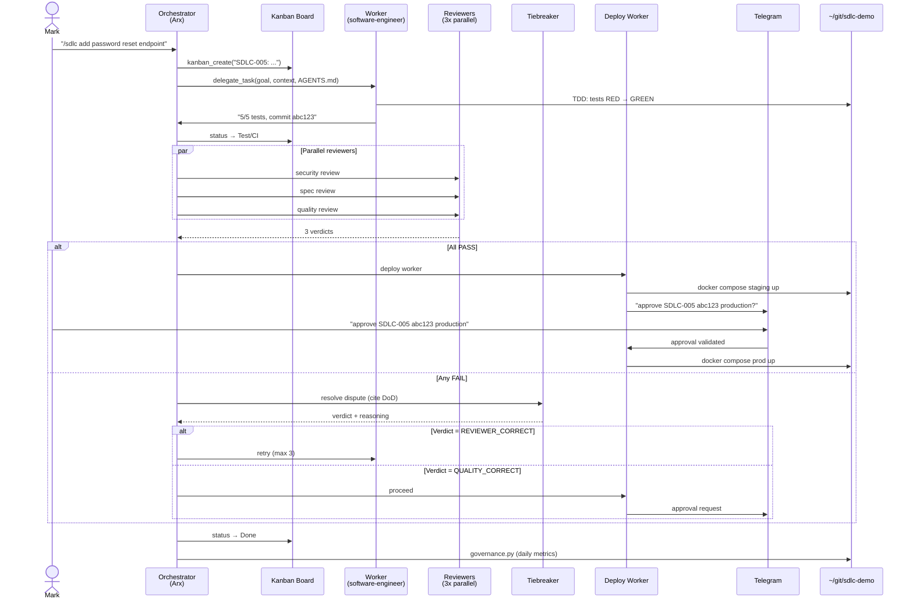
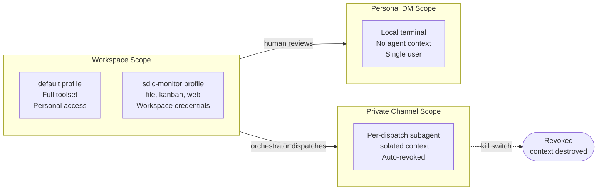
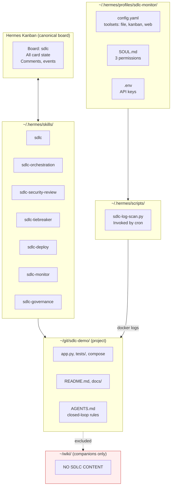
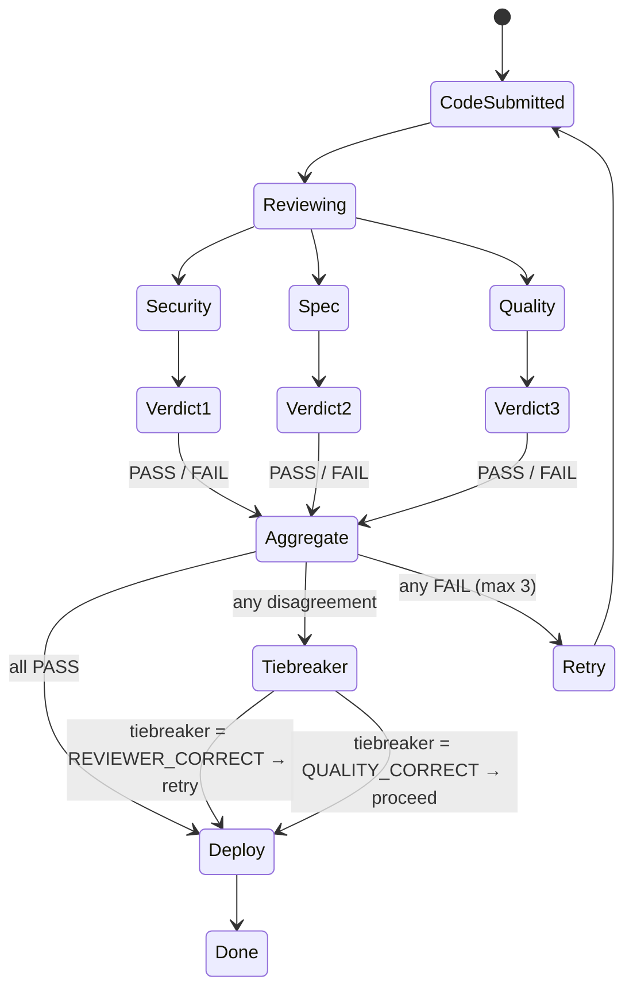
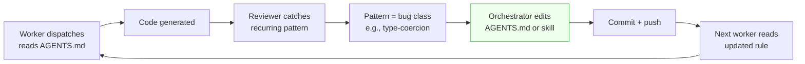

# Architecture

The SDLC pipeline that built this demo project. Built on [Hermes Agent](https://hermes-agent.nousresearch.com/) profiles + subagents, modeled on Anthropic's three-article pattern ([security](https://claude.com/blog/how-anthropic-secures-its-ai-native-software-development-lifecycle), [identity](https://claude.com/blog/agent-identity-access-model), [migration](https://claude.com/blog/ai-code-migration)).

## The 8-Node Cycle

The SDLC is a cycle, not a pipeline. Monitor feeds back to Ideation. Governance is cross-cutting, not a stage.

## What Runs When

The cycle is real but the rates differ. Here's how often each node fires in this demo:

| Node | Trigger | Frequency | Latency |
|------|---------|-----------|---------|
| Ideation | Human or monitor | Ad-hoc | n/a |
| Plan | Orchestrator | Per P0/P1 card | <2s |
| Code | Worker subagent | Per card | 30s–2min |
| Test/CI | Orchestrator | Per card | 1–2min (3 reviewers in parallel) |
| Deploy | Orchestrator | Per card | 30s (Docker rebuild) + human reply wait |
| Done | Orchestrator | Per card | <1s |
| Monitor | Cron | Every 15 min | <5s |
| Governance | Cron | Daily 8 AM | <30s |

## One Card, End-to-End

Sequence of a typical P1 card from creation to deployment.

## Identity Scopes

Three scopes from Anthropic's agent identity blog, mapped to Hermes profiles:

**Revocability:** Deleting `~/.hermes/profiles/sdlc-monitor/` ends its access. Subagent contexts die when the parent session ends. Personal DM is a person, not a credential.

## Storage Map

Where each piece of state lives. Boundary discipline matters.

## Multi-Reviewer AND-Gate Detail

Three reviewers run in parallel with isolated contexts. All three must PASS for the card to advance. Adversarial mindset.

## Closed Loop

When a reviewer catches a recurring pattern, the orchestrator edits the rulebook — not the code. Future workers read the updated instructions on first dispatch.

**Example:** SDLC-001 reviewers caught `bool-as-age` and missing-email-type-guard holes. Orchestrator appended two lines to the project's `AGENTS.md` under "Security Rules". SDLC-002's worker read them first and never repeated the bug class.

## More Reading

- [INCIDENT-RESPONSE.md](INCIDENT-RESPONSE.md) — what happens when the monitor catches a production issue
- [REVIEW-PROCESS.md](REVIEW-PROCESS.md) — deeper on the multi-reviewer pattern and tiebreaker
- [DEPLOYMENT.md](DEPLOYMENT.md) — staging vs prod infrastructure
- [API.md](API.md) — endpoints and request/response shapes
- [SDLC-SYSTEM.md](SDLC-SYSTEM.md) — concise integration guide for the SDLC system