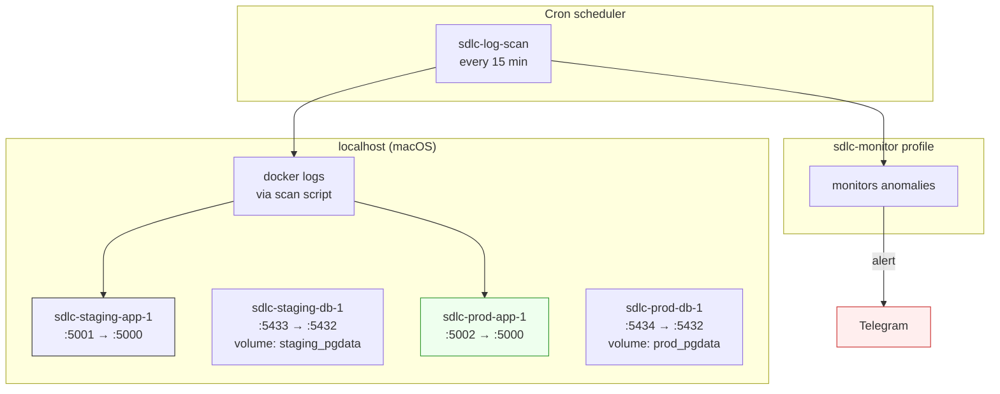
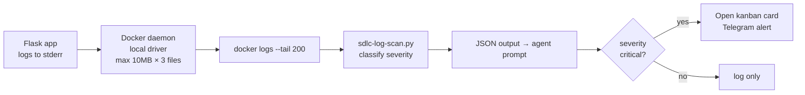

# Deployment

Two-environment infrastructure: staging and production, separate Docker Compose projects, separate PostgreSQL volumes, separate host ports.

## Architecture



## Components

| Component | Staging | Production |
|-----------|---------|------------|
| App container | `sdlc-staging-app-1` | `sdlc-prod-app-1` |
| Host port | 5001 | 5002 |
| Postgres container | `sdlc-staging-db-1` | `sdlc-prod-db-1` |
| Postgres host port | 5433 | 5434 |
| Data volume | `sdlc-staging_staging_pgdata` | `sdlc-prod_prod_pgdata` |
| Docker project name | `sdlc-staging` | `sdlc-prod` |

The project names (`-p`) are critical — they isolate the volumes and networks so both can coexist on the same host.

## Bring Up

```bash
# Staging (always available for the SDLC pipeline)
cd ~/git/sdlc-demo
docker compose -f docker-compose.staging.yml -p sdlc-staging up -d --build

# Production (deployed after human approval via Telegram)
docker compose -f docker-compose.prod.yml -p sdlc-prod up -d --build
```

## Health Checks

Both environments expose `/health`:

```bash
curl http://localhost:5001/health    # staging
curl http://localhost:5002/health    # production
```

Expected response:
```json
{"db": "connected", "status": "healthy"}
```

The health endpoint itself does a `SELECT 1` against PostgreSQL to confirm the DB connection is alive, not just that the Flask process is running.

## Log Pipeline



The `local` driver rotates logs at 10MB × 3 files. Docker writes to `/var/lib/docker/containers/<id>/` internally; the scanner reads via `docker logs` so no host-side bind-mount is needed.

## Smoke Tests

After any deploy:

```bash
# Both must return 200
curl -s -o /dev/null -w "%{http_code}\n" http://localhost:5001/health  # 200
curl -s -o /dev/null -w "%{http_code}\n" http://localhost:5002/health  # 200

# Test the data layer
curl -s http://localhost:5001/api/users
curl -s http://localhost:5002/api/users
```

## Tear Down

```bash
docker compose -f docker-compose.staging.yml -p sdlc-staging down
docker compose -f docker-compose.prod.yml -p sdlc-prod down

# Add -v to also remove volumes (destroys DB data)
docker compose -f docker-compose.prod.yml -p sdlc-prod down -v
```

## Production Safety

**No production deploy without human approval.** The Deploy stage sends a Telegram message with a structured approval format:

```
approve SDLC-NNN <commit-sha> production
```

The approval is validated against:
- Card ID must exist in kanban
- Commit SHA must match the deploy commit
- "production" keyword required
- Chat ID authenticated (must be 8788236757)
- 1-hour expiry
- Single-use token

A bare "approve" is rejected. A `reject SDLC-NNN <reason>` cancels the deploy.

## Backup / Restore

PostgreSQL data lives in Docker named volumes. Backup:

```bash
# Backup staging DB
docker exec sdlc-staging-db-1 pg_dump -U sdlc_user sdlc_demo > staging_backup.sql

# Backup prod DB
docker exec sdlc-prod-db-1 pg_dump -U sdlc_user sdlc_demo > prod_backup.sql

# Restore
cat staging_backup.sql | docker exec -i sdlc-staging-db-1 psql -U sdlc_user sdlc_demo
```

For production, automate with a daily cron that does `pg_dump` and ships to S3.

## More Reading

- [ARCHITECTURE.md](ARCHITECTURE.md) — system-wide architecture
- [API.md](API.md) — endpoints, status codes, error format
- [INCIDENT-RESPONSE.md](INCIDENT-RESPONSE.md) — what happens when monitoring catches a problem