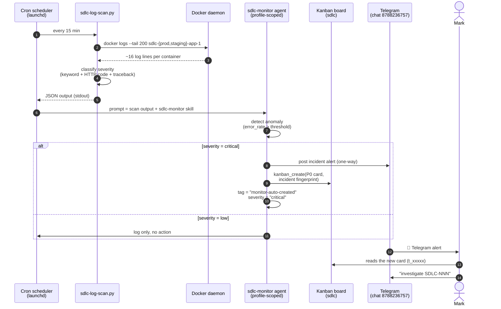
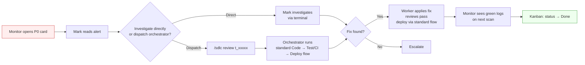

# Incident Response

The Monitor node in the cycle is autonomous. It runs every 15 minutes on the `sdlc-monitor` Hermes profile, scans production logs via `docker logs`, classifies severity, and — when something is wrong — opens a kanban card and posts to Telegram. No human in the loop until notification.

## The Flow



## Severity Classification

The scanner uses three detection layers, in order of specificity:

| Pattern | Matches | Severity |
|---------|---------|----------|
| `CRITICAL` keyword | Custom loggers, `level=critical` | CRITICAL |
| `ERROR` keyword / `level=error` / `\[ERROR\]` | Flask, gunicorn, app logs | ERROR |
| HTTP 4xx/5xx in Werkzeug | `"GET /path HTTP/1.1" 500 -` | ERROR |
| `Traceback (most recent call last)` | Python traceback lines | ERROR |

Then it computes error_rate = (errors + criticals) / total_lines. Severity thresholds:

| error_rate | Output severity |
|------------|-----------------|
| ≥ 0.20 | `critical` |
| ≥ 0.10 | `high` |
| > 0 | `medium` |
| 0 | `low` |

## Dedup via Fingerprint

The agent computes a fingerprint from the scan output to avoid re-firing on the same incident:

```
fingerprint = sha256(
  service         # container name (sdlc-prod-app-1, sdlc-staging-app-1)
  + exception_type # psycopg2.OperationalError, KeyError, etc.
  + endpoint       # /api/users, /health, etc.
)
```

If a card with the same fingerprint already exists in `ready` state, the monitor does **not** create a duplicate. It appends a comment with new evidence and increments the count.

This is what made SDLC-005's title say "staging, recurrence" — same fingerprint class as SDLC-004, different scope.

## The 3-Permission Boundary

The `sdlc-monitor` profile can ONLY:

1. **Read logs** via the scan script (executed by cron scheduler at host level, not by the agent)
2. **Write docs/kanban** — open cards, post comments
3. **Post to Telegram** — one-way alert sink

It CANNOT:

- Write code or modify any project
- Run `docker exec` into containers
- Deploy anything
- Coordinate with other agents

The boundary is enforced at the toolset level (`disabled_toolsets` in `~/.hermes/profiles/sdlc-monitor/config.yaml`), not by prose instructions. If the agent tried to call `terminal` or `delegation`, the call would fail.

## From Alert to Fix

After the monitor opens a card and notifies Mark:



The monitor's responsibility ends when the card is created and the alert is sent. The fix is the standard pipeline — same Plan → Code → Review → Deploy as a human-initiated feature.

## Testing the Loop

To verify the full path:

```bash
# 1. Trigger a real error
docker stop sdlc-prod-app-1
curl -s -o /dev/null http://localhost:5002/api/users  # returns 503
docker start sdlc-prod-app-1

# 2. Force a scan (don't wait 15 min)
hermes cron run 587ba73b9392 --accept-hooks

# 3. Watch
HERMES_KANBAN_BOARD=sdlc hermes kanban list   # new card appears
# Check Telegram DMs                          # alert arrives
```

Or, for a synthetic test without affecting real Docker:

```bash
# Append fake errors to the log file directly
# (only useful for testing the parser, not the live flow)
python3 ~/.hermes/scripts/sdlc-log-scan.py     # manual scan
```