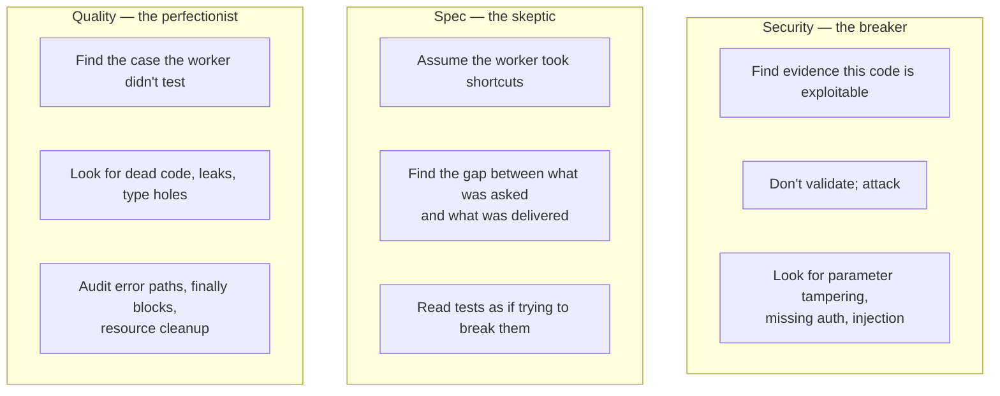
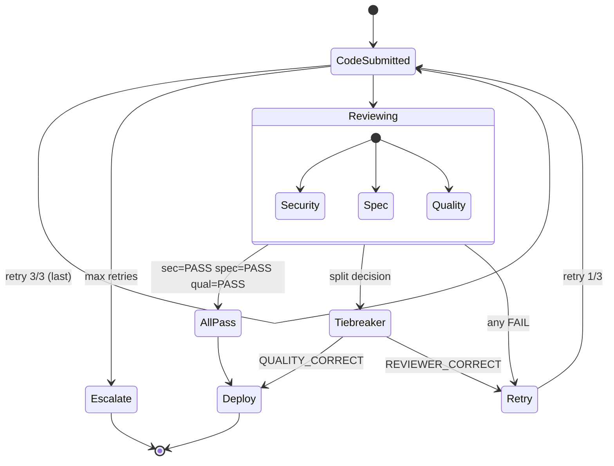

# Review Process

The Test/CI stage runs three reviewers in parallel with isolated contexts. Each has an adversarial mindset. The AND-gate requires all three to PASS — or a tiebreaker to rule.

## The Three Reviewers

| Reviewer | Skill | Looks for | Catches |
|----------|-------|-----------|---------|
| **Security** | `sdlc-security-review` | Injection (SQL, command, code), auth, data exposure, log injection | OWASP Top 10, parameter tampering, missing auth |
| **Spec** | (in `sdlc-orchestration`) | DoD coverage, edge cases, missed requirements | Tests that pass but don't actually test the requirement |
| **Quality** | (in `sdlc-orchestration`) | Dead code, missing error handling, type hints, DRY violations, cargo-cult patterns | Subtle bugs in error paths, leaks, type-coercion holes |

Each reviewer is dispatched as an isolated subagent with no shared context with the worker. They read the same source files but interpret them through different adversarial lenses.

## Adversarial Mindset

The reviewer's job is **not** to validate. The job is to find what the worker got wrong.



## Tiebreaker Routing

When reviewers disagree (e.g., security says FAIL on missing auth, but the rest say PASS because the card isn't tagged as security-tier), the orchestrator dispatches a **tiebreaker** subagent with the dispute cited as the prompt.

```mermaid
sequenceDiagram
    participant Orch as Orchestrator
    participant Sec as Security
    participant Sp as Spec
    participant Q as Quality
    participant TB as Tiebreaker

    par Parallel review
        Orch->>Sec: review code
        Orch->>Sp: review code
        Orch->>Q: review code
    end

    Sec-->>Orch: FAIL (missing auth on /api/users/<id>)
    Sp-->>Orch: PASS
    Q-->>Orch: PASS

    Orch->>Orch: 2 PASS + 1 FAIL → tiebreaker
    Orch->>TB: resolve dispute<br/>cite: card DoD, project AGENTS.md,<br/>specific code lines
    TB->>TB: read all 3 reviewer verdicts
    TB->>TB: do not vote; rule

    alt Tiebreaker verdict
        TB-->>Orch: REVIEWER_CORRECT<br/>(security finding stands)
        Note over Orch: retry card<br/>worker fixes
    else
        TB-->>Orch: QUALITY_CORRECT<br/>(security finding is wrong,<br/>not relevant to this tier)
        Note over Orch: proceed to deploy
    end
```

**Tiebreaker rule:** The tiebreaker does not vote. It rules based on the card's DoD (Definition of Done), the project's `AGENTS.md`, or specific code lines. If two reviewers say PASS and one says FAIL, the tiebreaker decides whether the FAIL is a real defect or an over-strict call.

## AND-Gate Outcomes



## Proven Cards

Three of the five cards in this demo went through retry:

| Card | Retries | Outcome |
|------|---------|---------|
| SDLC-001 | 1 (security + quality) | Security found XSS-adjacent issue, quality found type-coercion bug. Both fixed. |
| SDLC-002 | 1 (quality only) | Quality caught `update_user_email` had duplicated validation. Tiebreaker ruled QUALITY_CORRECT, then retry refactored to `_validate_email()` helper. |
| SDLC-003 | 2 (quality only) | First: dead code, missing DB error handling, negative IDs. Second: resource leak in `finally` block. Both fixed. |

## Retry Budget

| Retries used | Action |
|--------------|--------|
| 0–3 | Card continues to retry with each fix |
| 3 | Escalate to Mark via Telegram with full review history |

The retry budget is per-card. The monitor profile doesn't reset it; the orchestrator does after a successful deploy.

## Closed Loop Integration

When a reviewer finds the **same class of bug** across multiple cards, the orchestrator edits the relevant rule:

- Security findings → project `AGENTS.md` "Security Rules" section
- Quality findings → `AGENTS.md` "Code Conventions" section or new skill
- Spec findings → card template improvements

After the edit, future worker dispatches read the updated rules first and avoid the pattern. The reviewer no longer needs to find it.

**Concrete example:** SDLC-001 caught bool-as-age in input validation. Orchestrator appended to `AGENTS.md`: `Type-coercion check: isinstance(x, int) accepts bool. Use type(x) is int or isinstance(x, int) and not isinstance(x, bool).` SDLC-002's worker read that rule first and never repeated the pattern.